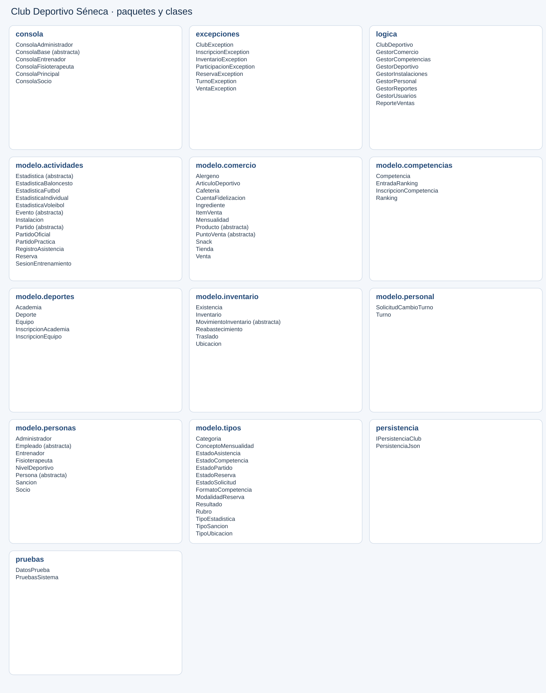
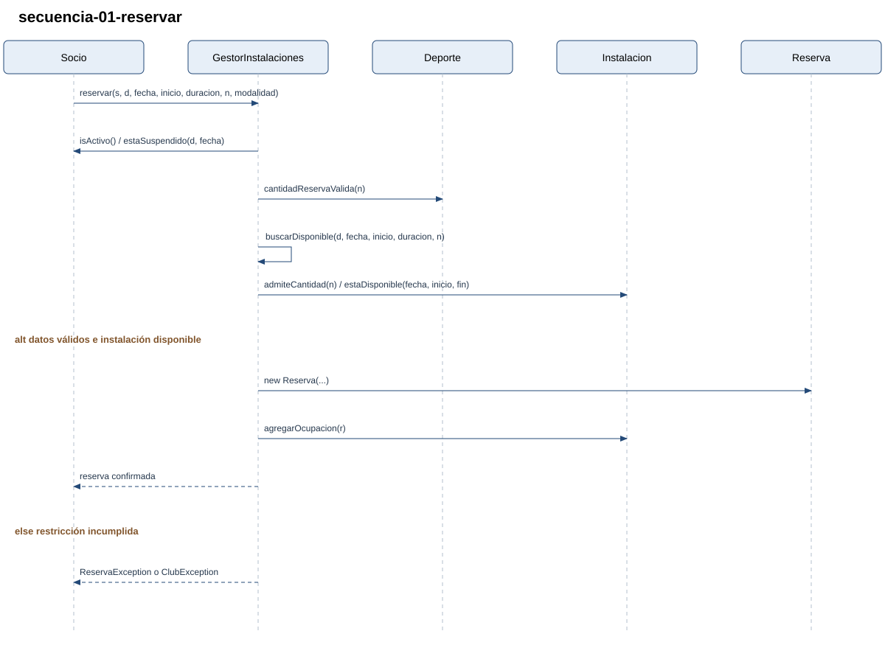
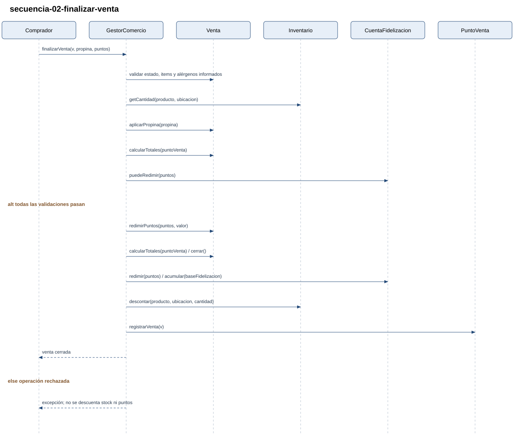
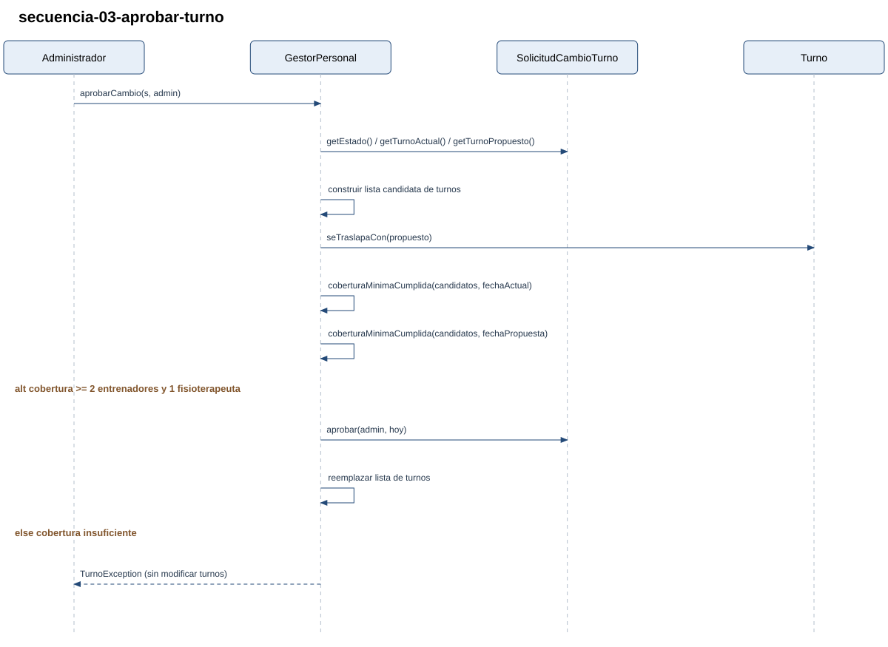
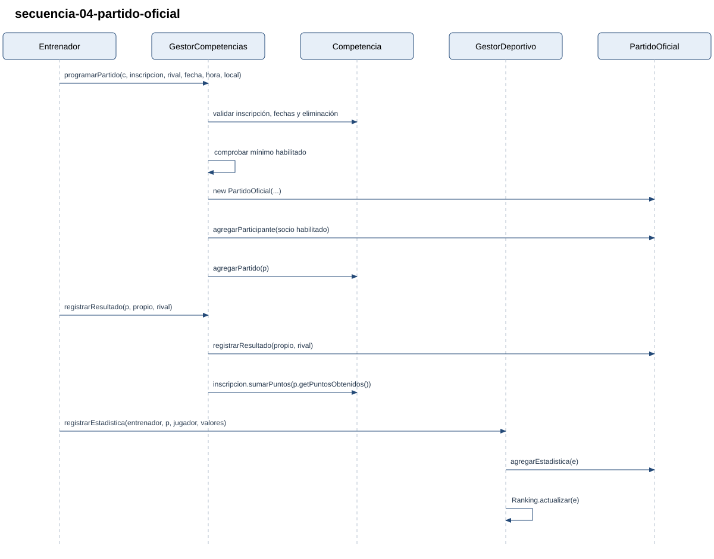
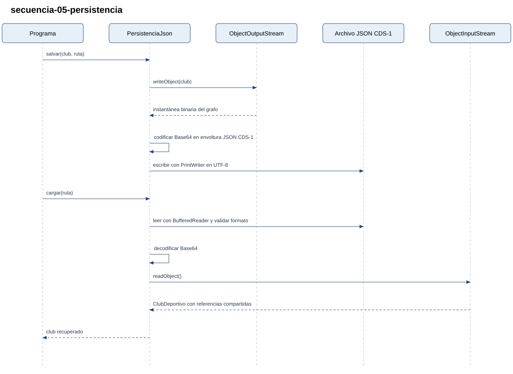

# Diseño de la implementación

Referencia: **Modelo_clases_final.pdf**, proporcionado por el usuario.

La aplicación implementa los **88 tipos definidos en ese PDF**, con sus paquetes,
herencias, atributos, relaciones y operaciones. Se agregaron constructores,
accesores y métodos privados de validación para poder crear y utilizar los objetos.
El paquete `pruebas` contiene dos programas de demostración para la entrega.

## Organización

| Paquete | Responsabilidad según el modelo |
|---|---|
| `modelo.personas` | Persona, socio, empleados, niveles y sanciones |
| `modelo.deportes` | Deporte, equipos, academias e inscripciones |
| `modelo.actividades` | Instalaciones, eventos, reservas, entrenamientos, partidos y estadísticas |
| `modelo.competencias` | Competencias, inscripciones oficiales y rankings |
| `modelo.personal` | Turnos y solicitudes de cambio |
| `modelo.inventario` | Ubicaciones, existencias y movimientos |
| `modelo.comercio` | Productos, ventas, fidelización y mensualidades |
| `modelo.tipos` | Las 14 enumeraciones mostradas en el PDF |
| `logica` | ClubDeportivo, gestores y ReporteVentas |
| `persistencia` | IPersistenciaClub y PersistenciaJson |
| `consola` | ConsolaPrincipal, ConsolaBase y las cuatro consolas por rol |
| `excepciones` | ClubException y las seis excepciones específicas del modelo |

`ClubDeportivo` compone los gestores. Las entidades conservan su estado y aplican
reglas locales; los gestores coordinan operaciones que afectan a varios objetos.
Las clases abstractas e interfaces conservan la jerarquía del PDF. Las consultas
devuelven colecciones de sólo lectura para proteger las relaciones almacenadas.

## Criterios de implementación

- Categorías: Sub-13 = 0–13, Sub-15 = 14–15, Sub-17 = 16–17, Mayores = 18–120,
  exactamente como están enumeradas en el PDF. Los niveles deportivos son 1–10.
- Equipos y academias validan cupo, inscripción, categoría o nivel. El gestor
  impide pertenecer a más de un equipo del mismo deporte.
- Las reservas comprueban disciplina, cantidad, mantenimiento, horario y ocupación.
  Se usan intervalos `[inicio, fin)` para permitir eventos contiguos. Cancelar una
  reserva libera la instalación y conserva la reserva en el historial.
- Las sanciones usan `TipoSancion`, fecha inicial, fecha final y deporte, como
  define `Sancion`. Una amonestación por sí sola no es una suspensión.
- Los entrenamientos registran convocados, asistencia y nota opcional entre 1 y 5.
- Los partidos de práctica comprueban niveles, con excepción del rival entrenador
  de esa disciplina. Los oficiales utilizan la nómina de InscripcionCompetencia.
- Las estadísticas sólo usan los atributos del PDF: goles/asistencias,
  puntos/rebotes, aces/bloqueos o puntosAnotados/gano. Se registra una estadística
  por jugador y partido finalizado; los mapas se pasan a crearEstadistica.
- Los formatos de competencia se representan con FormatoCompetencia y la fase del
  partido oficial. Se acumulan puntos y se obtiene la tabla con los métodos del PDF.
- Los cambios de turno conservan la cobertura de dos entrenadores distintos y un
  fisioterapeuta durante todo el horario de atención de las fechas afectadas.
- Las ventas validan productos, existencias, alérgenos, impuestos, propina y puntos
  antes de descontar inventario. Los movimientos conservan producto, ubicación y
  administrador. Los reportes filtran fechas y agrupan por rubro y mes.

El PDF especifica las firmas de varios cálculos, pero no todas sus fórmulas. Para
concretar esos métodos se usaron estas decisiones internas:

| Método o configuración | Implementación |
|---|---|
| `calcularDescuento` de Tienda | Empleado 15%, socio 8%, sin acumular |
| Impuestos y propina sugerida | IVA 19%, impoconsumo 8%, propina sugerida 10%, como en el PDF |
| Fidelización | 1 punto por $1000 completos de base pagada; cada punto redimido vale $10 |
| `puntosPor` de Competencia | Victoria 3, empate 1, derrota 0 |
| Ranking de fútbol | 3 × goles + asistencias |
| Ranking de baloncesto | puntos + rebotes |
| Ranking de voleibol | 2 × aces + bloqueos |
| Ranking individual | +20 al ganar, −10 al perder; puntaje inicial 1000 y mínimo 0 |
| Empate de puntajes | Orden estable por documento o nombre, según la tabla |

Los cupos, horarios, posiciones, duración y diferencia de niveles se configuran al
crear las entidades. Los valores de `DatosPrueba` son datos de ejemplo.

## Persistencia y ejecución

`IPersistenciaClub` contiene `cargar` y `salvar`. `PersistenciaJson` escribe una
envoltura JSON versionada, con el grafo de objetos Java serializado en Base64 en
el campo `datos`. Esto conserva las referencias compartidas y las relaciones
bidireccionales. La carga valida el formato y filtra los tipos admitidos; la
escritura reemplaza el archivo mediante un temporal. El formato del archivo es una
decisión de implementación, ya que el PDF no fija un esquema de persistencia.

Los datos están en `ClubDeportivo/datos`, separados de `src`. Las consolas del
modelo permiten iniciar sesión y consultar el resumen del rol. La lógica se
demuestra con `PruebasSistema`, sin solicitar información para cada escenario.

Se verificaron los **88 tipos** y la presencia de **187 operaciones del modelo**.
La compilación con Java 17 y `-Xlint:all` no presenta advertencias. El programa de
pruebas finaliza con **46 verificaciones correctas**, incluyendo persistencia,
inscripciones, reservas, sanciones, estadísticas, ventas, inventario y turnos.

## Diagramas

Los diagramas se obtuvieron de esta implementación y se entregan con sus fuentes:

- [Clases de diseño: atributos, métodos y relaciones](diagramas/clases-diseno.puml).
- [Clases de alto nivel: tipos y relaciones](diagramas/clases-alto-nivel.puml).
- [Secuencia de reserva](diagramas/secuencia-01-reservar.puml).
- [Secuencia de venta](diagramas/secuencia-02-finalizar-venta.puml).
- [Secuencia de cambio de turno](diagramas/secuencia-03-aprobar-turno.puml).
- [Secuencia de partido oficial](diagramas/secuencia-04-partido-oficial.puml).
- [Secuencia de persistencia](diagramas/secuencia-05-persistencia.puml).

Implementación y documentación elaboradas con asistencia de IA a partir del PDF.
Solicitudes que guiaron esta versión: «solo necesito la implementacion del pdf no
lo otro» y «subelo con las mismas intrscciones de entrega y borrar lo que ya me diste».
